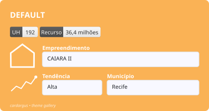
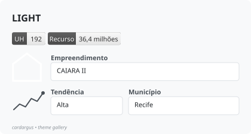
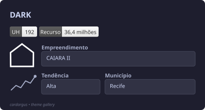
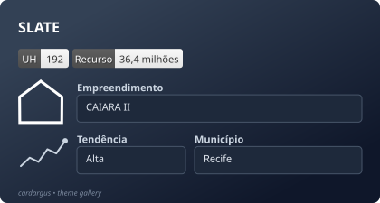
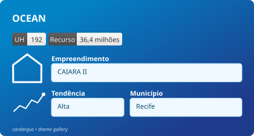
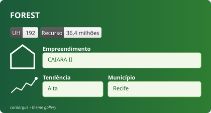
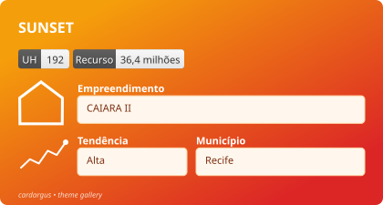
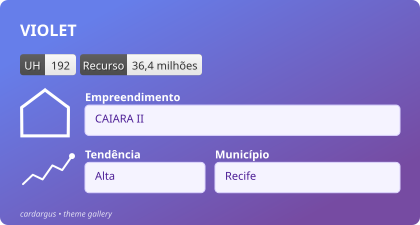

```{r, include = FALSE}
knitr::opts_chunk$set(
  collapse = TRUE,
  comment = "#>"
)
```

cardargus ships with eight preset themes. Apply one with the `theme` argument
of `svg_card()`, list them with `card_themes()`, and customize any component
with `card_theme()` — arguments set explicitly in the call always win over the
theme (see the *Customizing Cards* vignette).

Every card below was produced by the same call, varying only `theme`:

```{r gallery-code, eval=FALSE}
library(cardargus)

badges <- list(
  list(label = "UH", value = "192"),
  list(label = "Recurso", value = "36,4 milhões")
)

fields <- list(
  list(
    list(label = "Empreendimento", value = "CAIARA II", with_icon = TRUE)
  ),
  list(
    list(label = "Tendência", value = "Alta",
         with_icon = create_sparkline(c(2, 4, 3, 6, 5, 8),
                                      width = 55, height = 34)),
    list(label = "Município", value = "Recife")
  )
)

card <- svg_card(
  title = "DARK",           # one card per theme below
  badges_data = badges,
  fields = fields,
  theme = "dark",
  width = 420,
  footer = "cardargus • theme gallery"
)

# The images in this gallery were saved with font subsetting,
# so each self-contained SVG stays small:
save_svg(card, "theme-dark.svg", subset_fonts = TRUE)
```

The images are pre-rendered, self-contained SVGs with the Jost font embedded
(`subset_fonts = TRUE`), exactly as `save_svg()` produces them.

## default



## light



## dark



## slate



## ocean



## forest



## sunset



## violet



## Customizing a preset

Any component can be overridden, either per call or by building a reusable
theme object:

```{r custom, eval=FALSE}
# Per call: explicit arguments beat the theme
svg_card("ALERT", badges, fields, theme = "dark", bg_color = "#e74c3c")

# Reusable: tweak a preset once, use it everywhere
my_theme <- card_theme("ocean", footer_color = "#cceeff", font = "Montserrat")
svg_card("REPORT", badges, fields, theme = my_theme)
```
